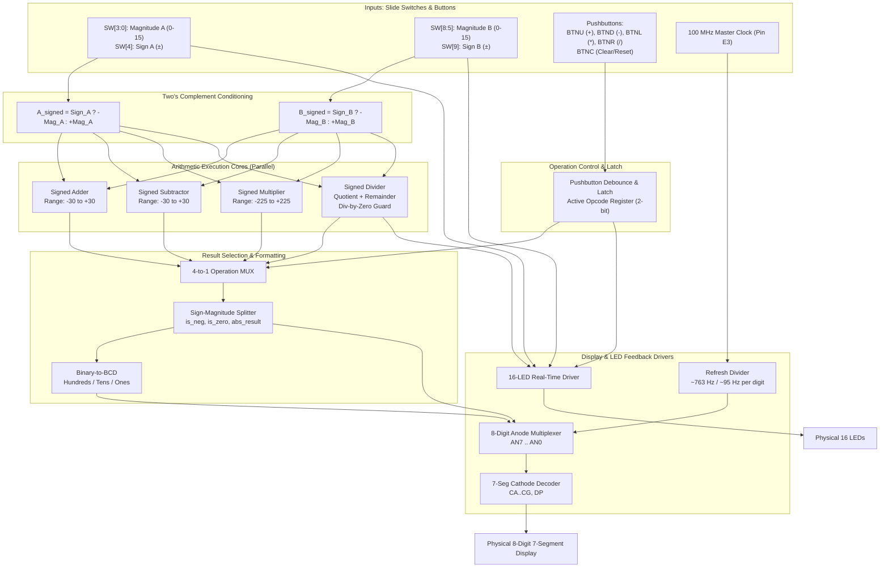

# 4-Bit Signed Calculator — Verilog HDL | Nexys A7 FPGA


> A fully signed 4-bit Arithmetic Logic Unit (ALU) designed in **Verilog HDL** for the **Digilent Nexys A7-100T** FPGA board. 
> This implementation supports signed two's complement arithmetic across all four core operations — with live hardware feedback via LEDs and a clean decimal 7-segment display output.

---

## 🧱 Design Foundation — Schematic Reference

This Verilog implementation is based on a previously verified **structural schematic** design built in Vivado's IP Integrator / Schematic Editor. 

➡️ [**View the Original Schematic Design Repository**](https://github.com/himanshushukla0/4-Bit-ALU-Architecture)

### What Changed from Schematic to Verilog

| Feature | Schematic Design | Verilog Implementation |
|:--|:--|:--|
| **Language / Tool** | Vivado Schematic Editor (Block-level) | Verilog HDL (Behavioral + Structural) |
| **Input Range** | 4-bit unsigned ($0$ to $15$) | 4-bit signed magnitude ($-15$ to $+15$) |
| **Sign Control** | DS / TS toggle wires | Dedicated slide switches (`SW[4]`, `SW[9]`) |
| **Operation Select** | Static MUX select lines (`M1`, `M0`) | Latching pushbutton controls (BTNU/D/L/R) |
| **Output Display** | 4-bit binary result on LEDs | Decimal 7-segment display with sign + zero rules |
| **Division Guard** | None | Division-by-zero hardware protection |
| **Multiplier Width** | 4-bit output (lower nibble only) | Full signed result ($-225$ to $+225$) |
| **Display Format** | Raw binary | Decimal, dynamic sign, leading zero suppression |

---

## 🗂️ Repository Structure

```
├── README.md               ← Architecture specification (this file)
├── .gitignore              ← Vivado project ignores
├── docs/
│   └── schematic_ref.png   ← Original structural schematic (reference)
└── hdl/                    ← (Upcoming) Verilog source & testbenches
    ├── calculator_top.v
    └── nexys_a7_calc.xdc
```

---

## 🏗️ System Architecture



---

## 🎛️ Physical Control Layout

### Slide Switches (Left → Right view)

```
SW15..SW10 │  SW9   │  SW8  SW7  SW6  SW5  │  SW4   │  SW3  SW2  SW1  SW0
───────────┼────────┼──────────────────────┼────────┼─────────────────────
   UNUSED  │ Sign B │     Magnitude B      │ Sign A │     Magnitude A
   (FREE)  │  (±B)  │   B3  B2  B1  B0    │  (±A)  │   A3  A2  A1  A0
           │0=+B    │       (0 to 15)      │0=+A    │       (0 to 15)
           │1=-B    │                      │1=-A    │
```

### Pushbuttons (Operation Cross)

```
                    ┌──────────────┐
                    │   BTNU (M18) │  →  ADD  ( + )
                    └──────┬───────┘
     ┌──────────────┐      │      ┌──────────────┐
     │  BTNL (P17)  │──────┼──────│  BTNR (M17)  │
     │   MUL  ( × ) │   ┌──┴──┐   │   DIV  ( ÷ ) │
     └──────────────┘   │BTNC │   └──────────────┘
                        │(N17)│
                        └──┬──┘
                           │
                    ┌──────┴───────┐
                    │   BTND (P18) │  →  SUB  ( - )
                    └──────────────┘
```

---

## 💡 LED Status Display (`LED[15:0]`)

```
┌──────┬──────┬──────┬──────┬──────┬──────┬──────┬──────────────┬──────┬──────────────┐
│LED15 │LED14 │LED13 │LED12 │LED11 │LED10 │ LED9 │  LED[8:5]    │ LED4 │  LED[3:0]    │
├──────┼──────┼──────┼──────┼──────┼──────┼──────┼──────────────┼──────┼──────────────┤
│Div/0 │Carry │Borrow│ Neg  │ DIV  │ MUL  │Sign B│  Magnitude B │Sign A│  Magnitude A │
│Error │ Flag │ Flag │Result│Active│Active│Glows │  (SW[8:5])   │Glows │  (SW[3:0])   │
│      │      │      │      │  (/) │  (*) │if -B │              │if -A │              │
└──────┴──────┴──────┴──────┴──────┴──────┴──────┴──────────────┴──────┴──────────────┘
```

---

## 🖥️ 7-Segment Display Formatting Rules

| Rule | Description |
|:--|:--|
| **Zero Result** | No sign shown — display shows plain `0` |
| **Negative Result** | `-` sign placed **immediately left** of most significant digit |
| **Leading Zeros** | Suppressed — unused digit anodes are disabled (blank) |
| **Division Output** | Left digits (`AN7:AN4`) = Remainder; Right digits (`AN3:AN0`) = Quotient |
| **Division by Zero** | Display shows `   Err  ` — `LED[15]` turns ON as error indicator |

### Example Display Outputs

```
12 + 9   → [blank][blank][blank][blank][blank][blank][ 2 ][ 1 ]
4  - 9   → [blank][blank][blank][blank][blank][  - ][ 0 ][ 5 ]
15 × 15  → [blank][blank][blank][blank][blank][ 2 ][ 2 ][ 5 ]
0        → [blank][blank][blank][blank][blank][blank][blank][ 0 ]
14 ÷ 3   → [ r ][blank][ 2 ][blank][blank][blank][ q ][ 4 ]
10 ÷ 0   → [blank][ E ][ r ][ r ][blank][blank][blank][blank]
```

---

## ⚙️ Arithmetic Core Specifications

| Operation | Formula | Input Range | Output Range |
|:--|:--|:--|:--|
| **Addition** | $A_{signed} + B_{signed}$ | $-15 \le A, B \le +15$ | $-30 \le \text{Sum} \le +30$ |
| **Subtraction** | $A_{signed} - B_{signed}$ | $-15 \le A, B \le +15$ | $-30 \le \text{Diff} \le +30$ |
| **Multiplication** | $A_{signed} \times B_{signed}$ | $-15 \le A, B \le +15$ | $-225 \le \text{Prod} \le +225$ |
| **Division** | $A = (Q \times B) + R$ | $-15 \le A, B \le +15$ | $Q: -15$ to $+15$, $R: 0$ to $14$ |

---

## ⏱️ Display Refresh Timing

| Parameter | Value |
|:--|:--|
| Master Clock | $100\text{ MHz}$ (Pin `E3`) |
| Refresh Counter Width | 20-bit (`refresh_cnt[19:0]`) |
| Digit Select Bits | `refresh_cnt[19:17]` |
| Anode Scanning Rate | $100\text{ MHz} \div 2^{17} \approx 763\text{ Hz}$ |
| Per-Digit Refresh Rate | $\approx 95.4\text{ Hz}$ — fully flicker-free |

---

## 🔌 Master Pin Constraints Summary

| Signal Group | Port | Package Pin | Description |
|:--|:--|:--:|:--|
| Clock | `clk` | **E3** | 100 MHz oscillator |
| Magnitude A | `sw[3:0]` | J15, L16, M13, R15 | Operand A bits |
| Sign A | `sw[4]` | **R17** | `1` = Negative A |
| Magnitude B | `sw[8:5]` | T18, U18, R13, T8 | Operand B bits |
| Sign B | `sw[9]` | **U8** | `1` = Negative B |
| ADD | `btnu` | **M18** | Select: Addition |
| SUB | `btnd` | **P18** | Select: Subtraction |
| MUL | `btnl` | **P17** | Select: Multiplication |
| DIV | `btnr` | **M17** | Select: Division |
| Reset | `btnc` | **N17** | Master Clear |
| Anodes | `an[7:0]` | U13, K2, T14, P14, J14, T9, J18, J17 | Digit enable (Active Low) |
| Cathodes | `seg[6:0]` | L18, T11, P15, K13, K16, R10, T10 | Segments CG..CA (Active Low) |
| Decimal Pt | `dp` | **H15** | Tied HIGH (OFF) |

---

## 📋 Upcoming: Verilog Implementation

The single-file Verilog implementation (`calculator_top.v`) will include all sub-modules in one synthesizable file:

- [ ] Clock divider & refresh counter
- [ ] Pushbutton debounce & opcode latch
- [ ] Sign conditioning (2's complement)  
- [ ] Signed adder / subtractor
- [ ] Signed multiplier (full-width output)
- [ ] Signed divider with div-by-zero guard
- [ ] 4-to-1 result multiplexer
- [ ] Binary-to-BCD converter
- [ ] 8-digit anode multiplexer
- [ ] 7-segment cathode decoder (with `-`, `E`, `r`, `q` characters)
- [ ] 16-LED output driver
- [ ] Master XDC constraints file

---

## 🔗 Related

- 📐 **Schematic Foundation:** [4-Bit-ALU-Architecture](https://github.com/himanshushukla0/4-Bit-ALU-Architecture) — The original structural schematic this Verilog design is based on.
