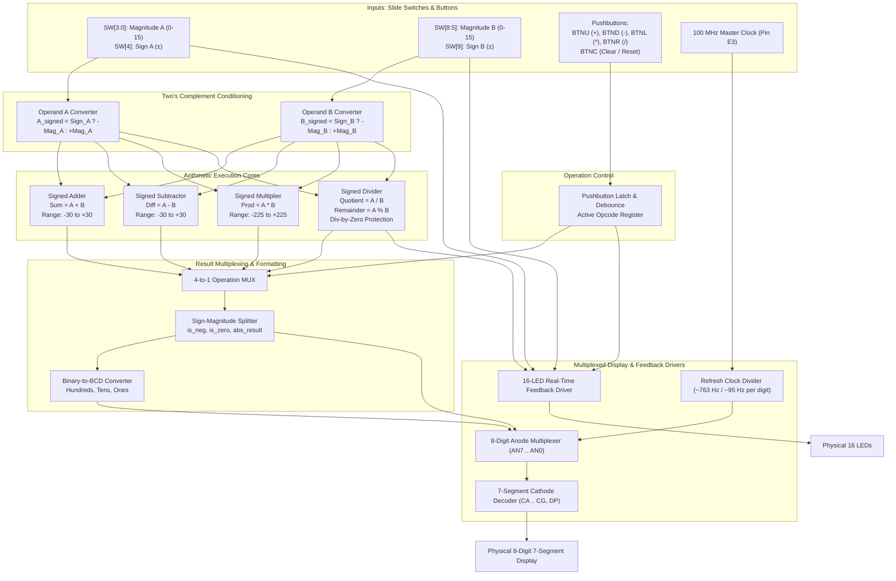

# 4-Bit Signed Calculator in Verilog (Nexys A7 FPGA)


-red)


A modular, hardware-tested **4-bit Signed Calculator** written in **Verilog HDL** for the **Digilent Nexys A7-100T FPGA**. 
This project expands upon the structural schematic architecture into a full-featured, hardware-tested digital system featuring:
* Signed Two's Complement Operations ($+$, $-$, $\times$, $\div$).
* Dynamic Button-Latched Operation Selection.
* Live Binary & Status LED Monitoring.
* Flicker-Free 8-Digit Common-Anode 7-Segment Multiplexing with leading zero suppression, dynamic sign positioning, and division-by-zero protection.

---

## 🏗️ System Architecture



---

## 🎛️ Physical Pinout & Control Layout

### 1. Slide Switches (`SW[9:0]`) — Reading Left-to-Right
Each operand features its **Sign switch located immediately to the left of its Magnitude switches**:

```
Board View (Left ➔ Right):
SW15..SW10 │  SW9   │ SW8  SW7  SW6  SW5 │  SW4   │ SW3  SW2  SW1  SW0
───────────┼────────┼────────────────────┼────────┼───────────────────
  UNUSED   │ Sign B │    Magnitude B     │ Sign A │    Magnitude A    
  (FREE)   │  (±B)  │    (B3..B0: 0-15)  │  (±A)  │    (A3..A0: 0-15) 
```

| Switch | Signal | Function | Description / Values |
| :--- | :--- | :--- | :--- |
| **`SW[3:0]`** | `mag_a[3:0]` | Magnitude A | 4-bit unsigned magnitude ($0$ to $15$) |
| **`SW[4]`** | `sign_a` | Sign A | `0` = Positive ($+A$), `1` = Negative ($-A$) |
| **`SW[8:5]`** | `mag_b[3:0]` | Magnitude B | 4-bit unsigned magnitude ($0$ to $15$) |
| **`SW[9]`** | `sign_b` | Sign B | `0` = Positive ($+B$), `1` = Negative ($-B$) |
| **`SW[15:10]`** | — | Spare / Unused | Reserved for future expansions |

---

### 2. Operation Pushbuttons (Directional Cross)
Pushbuttons latch the active arithmetic operation so results remain stable:

```
                    ┌───────────────┐
                    │  BTNU (Pin M18)│ ➔ ADD (+)
                    └───────┬───────┘
                            │
     ┌───────────────┐      │      ┌───────────────┐
     │  BTNL (Pin P17)│ ─────┼───── │  BTNR (Pin M17)│
     │   MUL (*)     │   ┌──┴──┐   │   DIV (/)     │
     └───────────────┘   │BTNC │   └───────────────┘
                         │(N17)│
                         └──┬──┘
                            │
                    ┌───────┴───────┐
                    │  BTND (Pin P18)│ ➔ SUB (-)
                    └───────────────┘
```

* **`BTNU` (Up):** Selects & latches **Addition** ($+$)
* **`BTND` (Down):** Selects & latches **Subtraction** ($-$)
* **`BTNL` (Left):** Selects & latches **Multiplication** ($\times$)
* **`BTNR` (Right):** Selects & latches **Division** ($\div$)
* **`BTNC` (Center):** **Master Reset / Clear** (Resets to Addition, clears state)

---

### 3. Real-Time Status LEDs (`LED[15:0]`)

```
LED15 │ LED14 │ LED13 │ LED12 │ LED11 │ LED10 │  LED9  │ LED8..LED5 │  LED4  │ LED3..LED0
──────┼───────┼───────┼───────┼───────┼───────┼────────┼────────────┼────────┼────────────
Div0! │ Carry │Borrow │  Neg  │  DIV  │  MUL  │ Sign B │   Mag B    │ Sign A │   Mag A    
Error │  Out  │  Out  │Result │Active │Active │ Glows  │ (Mirrors   │ Glows  │ (Mirrors   
Flag  │ Flag  │ Flag  │ Flag  │  (/)  │  (*)  │ if -B  │  SW[8:5])  │ if -A  │  SW[3:0])  
```

* **`LED[3:0]`**: Direct visual feedback of Input A magnitude.
* **`LED[4]`**: Lights up when Input A is negative.
* **`LED[8:5]`**: Direct visual feedback of Input B magnitude.
* **`LED[9]`**: Lights up when Input B is negative.
* **`LED[10]`**: Indicates **ADD** active.
* **`LED[11]`**: Indicates **SUB** active.
* **`LED[12]`**: Indicates **MUL** active.
* **`LED[13]`**: Indicates **DIV** active.
* **`LED[14]`**: **Carry / Overflow** indicator.
* **`LED[15]`**: **Division-by-Zero Error** warning light.

---

## 💡 8-Digit 7-Segment Display Formatting Rules

1. **Exact Zero Handling:** When the final calculation is zero, **no sign is shown**. The display shows strictly `0` on `AN0`.
2. **Negative Sign Placement:** The negative sign (`-`) dynamically shifts to appear **immediately to the left** of the most significant digit (e.g. `   -15`, never `-   15`).
3. **Leading Zero Suppression:** Leading zeros on unused digits are suppressed (anodes disabled).
4. **Division Display Split:**
   * **Left Digits (`AN7:AN4`):** Displays Remainder (e.g. `r  2`).
   * **Right Digits (`AN3:AN0`):** Displays Quotient (e.g. `q  4` or ` -4`).
   * **Division by Zero ($B = 0$):** Displays `   Err  ` across the display and turns on `LED15`.

---

## ⚡ Arithmetic Cores & Ranges

| Operation | Mathematical Definition | Output Dynamic Range | Display Format |
| :--- | :--- | :---: | :--- |
| **Addition** | $Sum = A_{signed} + B_{signed}$ | $-30 \le \text{Result} \le +30$ | Decimal (`-30` to `30`) |
| **Subtraction** | $Diff = A_{signed} - B_{signed}$ | $-30 \le \text{Result} \le +30$ | Decimal (`-30` to `30`) |
| **Multiplication**| $Prod = A_{signed} \times B_{signed}$ | $-225 \le \text{Result} \le +225$ | Decimal (`-225` to `225`) |
| **Division** | $A_{signed} = (Q \times B_{signed}) + R$ | $Q: -15 \text{ to } +15$<br>$R: 0 \text{ to } 14$ | Left: Remainder, Right: Quotient |

---

## ⏱️ Display Multiplexing Specification
* **Master Clock:** 100 MHz ($T = 10\text{ ns}$) from onboard oscillator (Pin `E3`).
* **Refresh Counter:** 20-bit free-running counter (`refresh_cnt[19:0]`).
* **Digit Scanning Rate:** Driven by `refresh_cnt[19:17]`:
  $$\text{Scanning Frequency} = \frac{100\text{ MHz}}{2^{17}} \approx 763\text{ Hz}$$
  $$\text{Per-Digit Refresh Rate} = \frac{763\text{ Hz}}{8} \approx 95.4\text{ Hz}$$
* Completely flicker-free to the human eye, eliminating switching ghosting.

---

## 📁 Repository Structure
```
├── README.md               # Complete System Architecture & Specifications
├── .gitignore              # Standard Vivado project ignores
├── docs/                   # Schematics & Architecture Diagrams
└── hdl/                    # (Upcoming) Production Verilog Implementation
```

---

## 📜 Next Phase: Verilog Implementation
The implementation will be synthesized and loaded into Vivado targeting the **Nexys A7-100T** as a single top-level source with full behavioral simulation testbenches.

